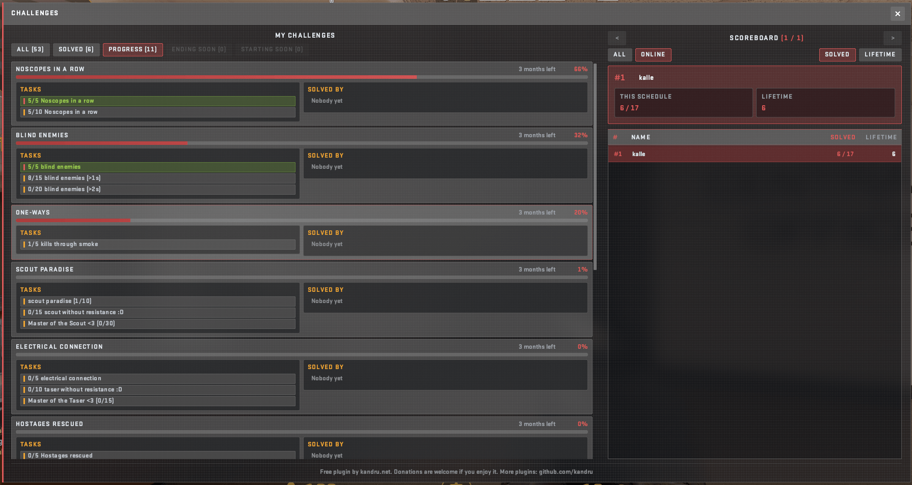

> [!WARNING]  
> You need to configure challenges! This plug-in comes with examples. READ THE [DOCS](https://kandru.github.io/cs2-challenges/docs/tutorial/) before asking!

# CounterstrikeSharp - Challenges

[](https://discord.gg/NtHCk5PWEt)
[](https://github.com/Kandru/cs2-challenges/releases/)
[](#license)
[](https://github.com/Kandru/cs2-challenges/issues)
[](https://www.paypal.com/donate/?hosted_button_id=C2AVYKGVP9TRG)



Create time-limited challenges for players. Each challenge is a YAML file with tasks that listen for game events (for example three headshots in a row). This plugin tracks progress. It does not grant rewards on its own - wire another plugin via server commands or `ChallengesShared` ([Plugin API](https://kandru.github.io/cs2-challenges/docs/reference/integration/)).

> [!TIP]
> Please consider a [donation](https://www.paypal.com/donate/?hosted_button_id=C2AVYKGVP9TRG) when you're using this plugin - it took a long time to build and improve - it only costs you a few dollars and would help me very much!

## Documentation

> [!IMPORTANT]
> Create a GitHub Issue for bugs, features, and improvements. Use Discord for everything else.

| | |
|---|---|
| [Tutorial](https://kandru.github.io/cs2-challenges/docs/tutorial/) | Install, examples, first challenge |
| [Challenge builder](https://kandru.github.io/cs2-challenges/builder/) | Visual editor for challenge YAML |
| [Challenges and tasks](https://kandru.github.io/cs2-challenges/docs/reference/challenges/) | Challenge / task fields |
| [Events](https://kandru.github.io/cs2-challenges/docs/reference/events/) / [Listeners](https://kandru.github.io/cs2-challenges/docs/reference/listeners/) | Task `type` values and attributes |
| [Rules](https://kandru.github.io/cs2-challenges/docs/reference/rules/) / [Actions](https://kandru.github.io/cs2-challenges/docs/reference/actions/) | When events count / completion side effects |
| [Schedules](https://kandru.github.io/cs2-challenges/docs/howto/schedules/) / [Settings](https://kandru.github.io/cs2-challenges/docs/reference/settings/) | Active windows and `Challenges.json` |

Source markdown lives in [`documentation/`](./documentation/).

## Features

- One YAML file per challenge (stored under `blueprints/`), with ordered tasks and `requires` dependencies inside the file.
- Track progress; notify other plugins via `ChallengesShared`, or run server console commands on task completion.
- Panorama HUD: round-start tracker and fullscreen `!c` / `!challenges` menu ([Workshop](https://steamcommunity.com/sharedfiles/filedetails/?id=3814533794)).
- Player language from `!lang` is stored and restored on reconnect.
- Build with Docker (`make debug` / `make release`) - no local .NET install required.
- Challenge builder and documentation on GitHub Pages ([live site](https://kandru.github.io/cs2-challenges/)).

## Running tests

The unit tests in [`tests/Challenges.Tests`](./tests/Challenges.Tests/) cover rule checks, progress simulation, the progress pipeline under load, load-time checks (demand, gates, aliases, validation) and the attribute providers. They need no game server: CounterStrikeSharp is loaded but never called.

```bash
make test
```

Without `make` (for example Git Bash on Windows):

```bash
MSYS_NO_PATHCONV=1 docker run --rm -v "$(pwd -W)":/src -v "$HOME/.nuget/packages":/root/.nuget/packages -w /src mcr.microsoft.com/dotnet/sdk:10.0 dotnet test tests/Challenges.Tests/Challenges.Tests.csproj
```

## Test servers

- CounterStrike.Party Ballerbude ([counterstrike.party](https://counterstrike.party) or `server.counterstrike.party:27030`)
- CounterStrike.Party Wingman ([counterstrike.party](https://counterstrike.party) or `server.counterstrike.party:27020`)

## Road map

- [X] Web builder to create challenges ([builder/](./builder/))
- [X] Documentation site with search ([docs](https://kandru.github.io/cs2-challenges/docs/))
- [ ] Spawn custom props on the map as a challenge
- [ ] Link possible values for all rules in documentation
- [ ] Discord integration
  - [X] Webhook for challenge completion
  - [X] Webhook when a new schedule starts
  - [ ] Webhook for player statistics at an interval

## License

Released under [GPLv3](/LICENSE) by [@Kandru](https://github.com/Kandru).

## Authors

- [@derkalle4](https://www.github.com/derkalle4)
